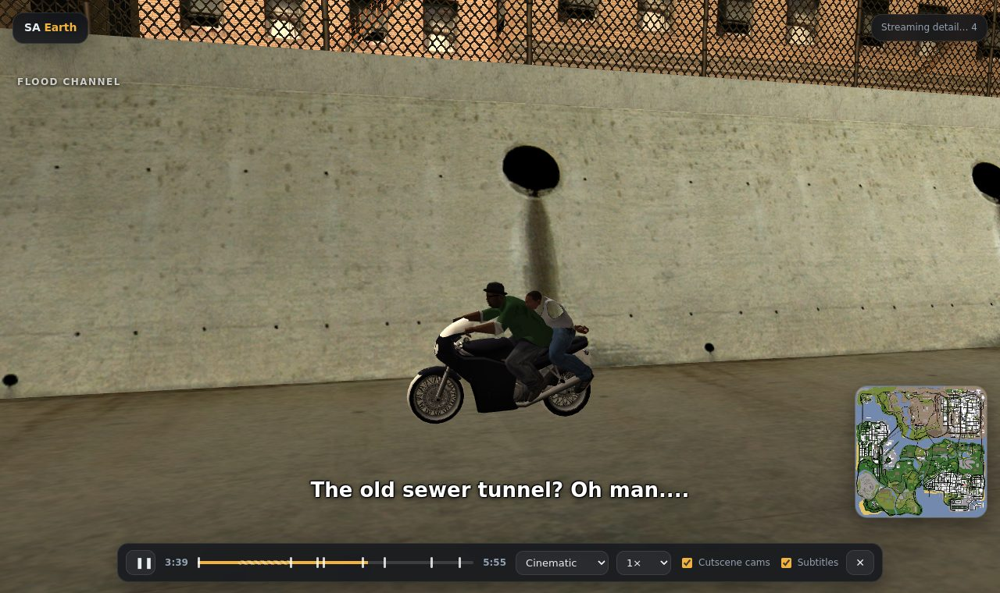
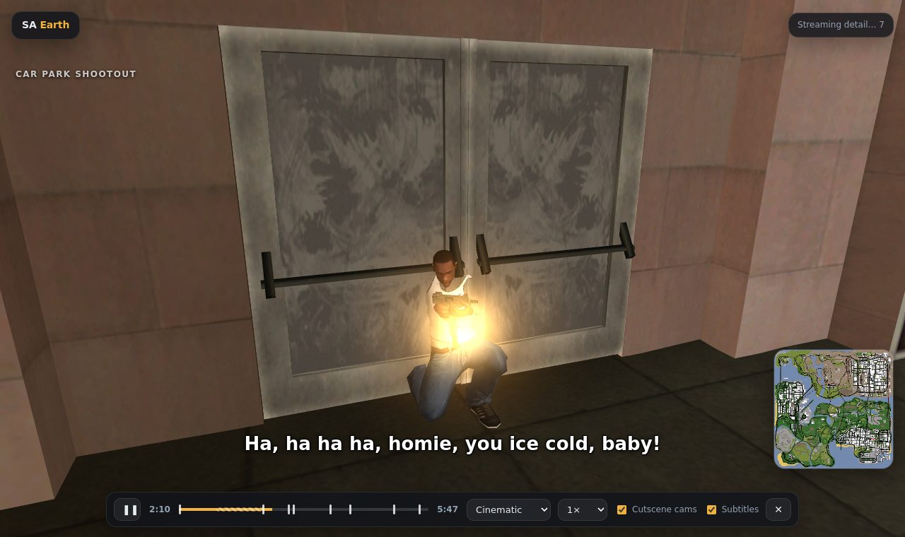
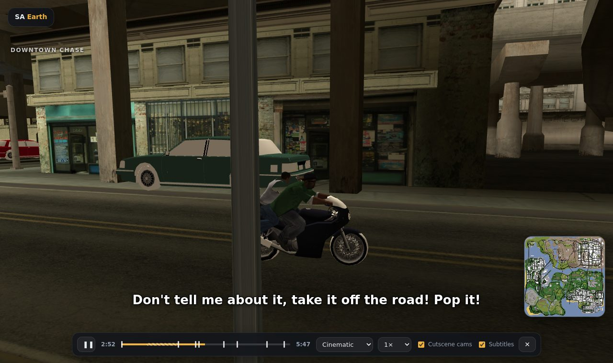
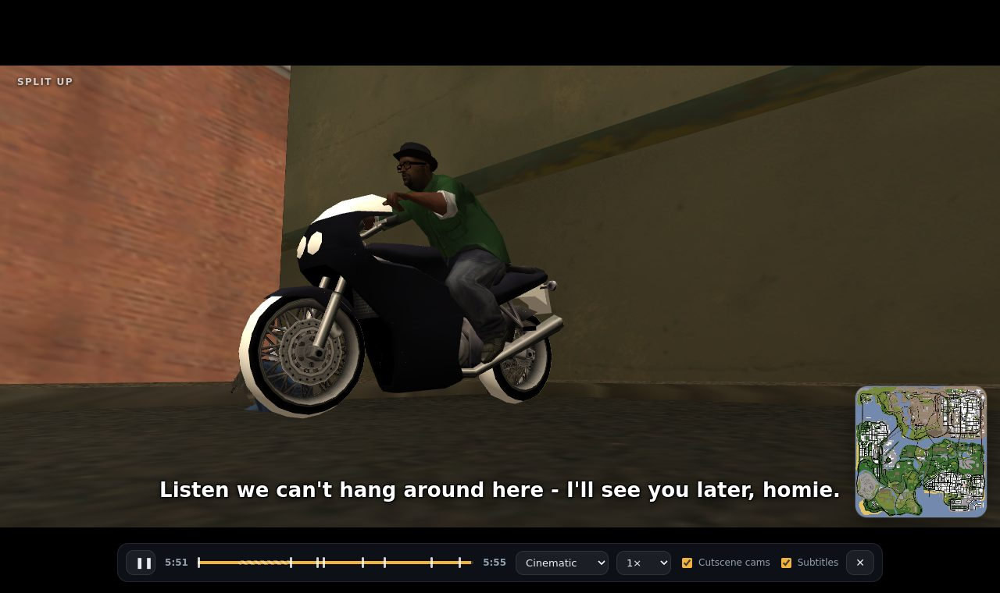
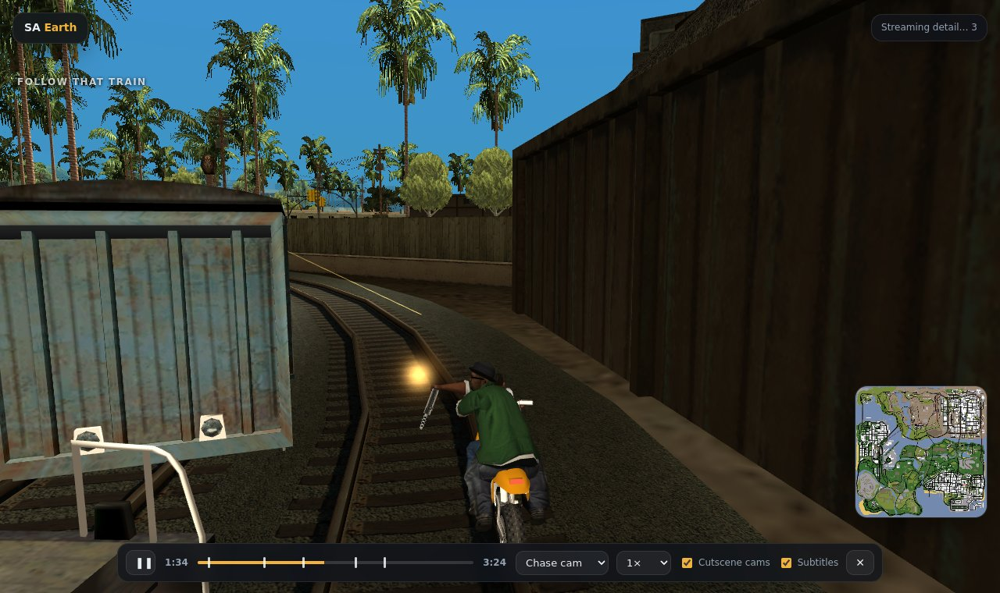
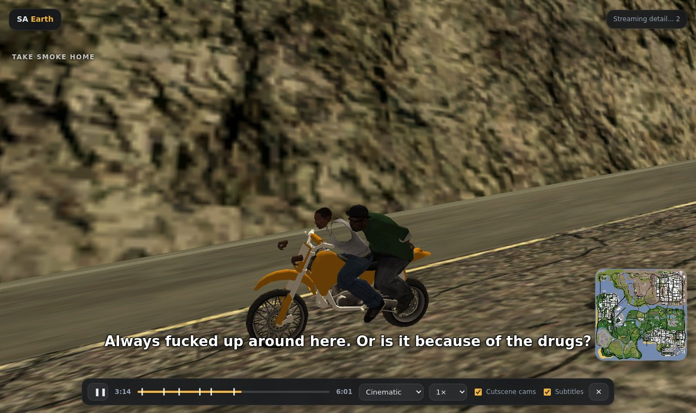

# SA Earth — a 3D map of GTA San Andreas, in your browser

**Live:** https://atharvdubey22ug-glitch.github.io/gta-sa-earth/

A live 3D map of the whole state of San Andreas: every building, road and hill, with traffic, boats, planes, pedestrians, a full day–night cycle, the game's weather and its own sound effects. And now you can watch **story missions play out live** on the map.

## Story missions (new)

Press **Missions** and pick one to watch it play out in the world, start to finish: the cars and bikes drive the game's own recorded routes, characters talk with the original voice lines and subtitles, cutscenes use the mission's own camera angles, and the gunfights, crashes and explosions happen where they happen in the game.

- **Just Business** (Big Smoke): the drive downtown, the shootout outside the Atrium, then the full BF-400 chase through downtown, the flood channel, the Packer ramp and the old storm drain
- **Wrong Side of the Tracks** (Big Smoke): Unity Station, then the Sanchez chase alongside the freight train while Smoke picks the Vagos off its roof, the on-coming train, the high road and the ride back to Grove Street
- Camera modes: **Cinematic** (an auto-director that knows where the action is going), **Chase cam**, **Helicopter** and **Free camera**, with the mission's cutscene cameras on or off
- Play / pause, scrub, chapter markers, 0.5×–2× speed and subtitles
- Interior scenes are skipped with a title card for now

How it's done: the viewer runs the mission's actual script from your `main.scm` in a small script interpreter, with an "autoplayer" standing in for you (driving where the script expects, getting into the right vehicles and shooting whatever the script marks as an enemy). The result is recorded as a timeline and replayed with the game's models, animations, car recordings (`carrec.img`), dialogue (`american.gxt`) and voices (`audio/SFX/SCRIPT`).

| | |
|---|---|
|  |  |
|  |  |
|  | |

## How it works

SA Earth doesn't host any game content. When you open the page, you point it at **your own copy of GTA San Andreas** and it reads the original files right in your browser: map archives, models, textures, lighting, road networks, animations and audio. Nothing is uploaded anywhere, and none of Rockstar's files live in this repository.

1. Open the live link in **Chrome or Edge** on a desktop.
2. Click **Open GTA San Andreas folder** and select the folder that contains `gta_sa.exe` (PC version).
3. Wait about 20–40 seconds while the map is built, then explore. Next time, use **Reopen** to skip the folder picker.

## Features

- Whole-map view with the game's own distant (LOD) models, streaming full detail as you get close
- Search places by district name, a clickable minimap from the game's radar, and a free-fly mode (**F**)
- Time-of-day slider driven by the game's `timecyc.dat`, with night windows, neon and street lights
- All 23 weather presets
- Road traffic, boats, airport vehicles, parked cars and planes, and aircraft overhead, using real models and paint colours
- Pedestrians with real skinned models and the game's walk animation
- 3D-positioned game audio: engines, horns, footsteps, pedestrian speech, wind and rain (**M** to mute)
- Story missions replayed live from the game's own scripts (see above)
- Car windows render as tinted glass instead of white, and head/tail lights get proper colours

| | |
|---|---|
|  |  |
|  |  |

## Controls

| Map view | Fly mode (**F**) |
|---|---|
| Drag to pan, right-drag to rotate/tilt, scroll to zoom, WASD to move | Mouse to look, WASD to move, E/Q up/down, Shift fast, Ctrl slow |

During a mission: **Space** play/pause, **C** switch camera, **←/→** skip 10 s, **Esc** leave.

## Notes

- Requires the PC version of GTA San Andreas (v1.0 data files). You need to own the game.
- Built with [three.js](https://threejs.org) and [three-mesh-bvh](https://github.com/gkjohnson/three-mesh-bvh). Audio bank layout, vehicle sound tables, mission-audio mapping and the car recording format are based on research by the [gta-reversed](https://github.com/gta-reversed/gta-reversed) project. Script opcode parameter tables come from the [Sanny Builder Library](https://library.sannybuilder.com).
- Fan project, not affiliated with or endorsed by Rockstar Games or Take-Two Interactive. Grand Theft Auto and San Andreas are trademarks of Take-Two Interactive.
