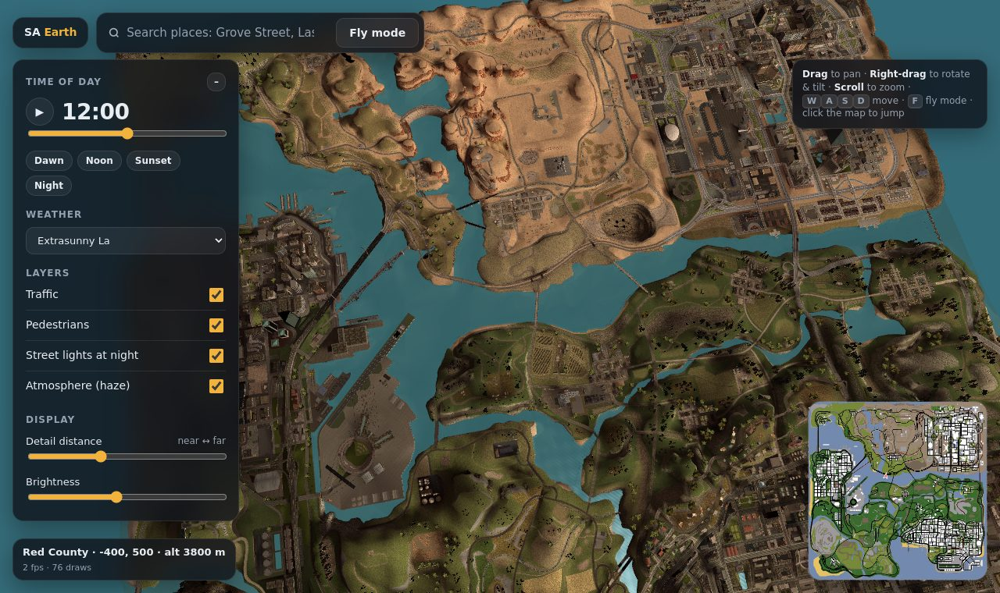
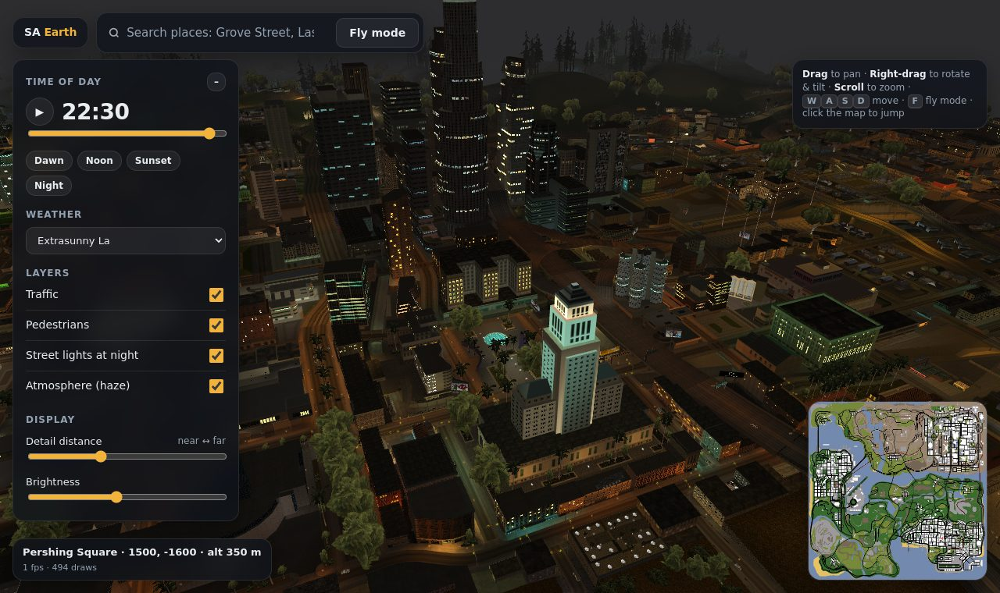
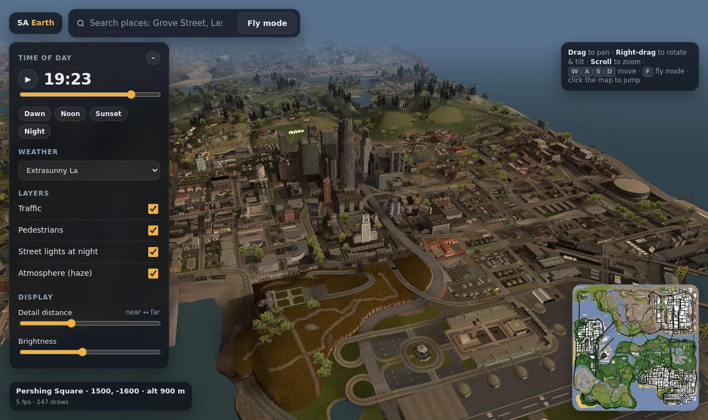
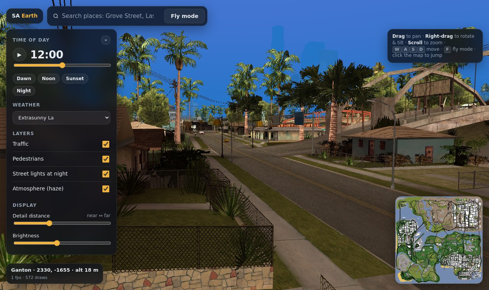
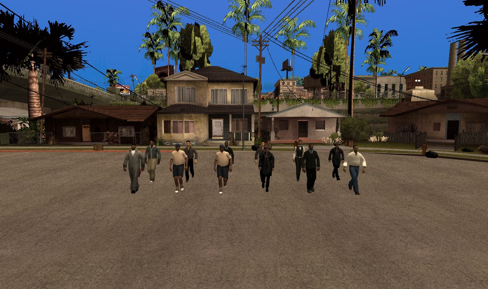

# SA Earth — a 3D map of GTA San Andreas, in your browser

**Live:** https://atharvdubey22ug-glitch.github.io/gta-sa-earth/

Fly over the whole state of San Andreas like Google Earth: every building, road and hill, with traffic, boats, planes, pedestrians, a full day–night cycle, the game's weather and its own sound effects.

## How it works

SA Earth doesn't host any game content. When you open the page, you point it at **your own copy of GTA San Andreas** and it reads the original files right in your browser: map archives, models, textures, lighting, road networks, animations and audio. Nothing is uploaded anywhere, and none of Rockstar's files live in this repository.

1. Open the live link in **Chrome or Edge** on a desktop.
2. Click **Open GTA San Andreas folder** and select the folder that contains `gta_sa.exe` (PC version).
3. Wait about 20–40 seconds while the map is built, then explore. Next time, use **Reopen** to skip the folder picker.

## Features

- Whole-map view with the game's own distant (LOD) models, streaming full detail as you get close
- Search places by district name, a clickable minimap from the game's radar, and a free-fly mode (**F**)
- Time-of-day slider driven by the game's `timecyc.dat`, with night windows, neon and street lights
- All 23 weather presets
- Road traffic, boats, airport vehicles, parked cars and planes, and aircraft overhead, using real models and paint colours
- Pedestrians with real skinned models and the game's walk animation
- 3D-positioned game audio: engines, horns, footsteps, pedestrian speech, wind and rain (**M** to mute)

| | |
|---|---|
|  |  |
|  |  |

## Controls

| Map view | Fly mode (**F**) |
|---|---|
| Drag to pan, right-drag to rotate/tilt, scroll to zoom, WASD to move | Mouse to look, WASD to move, E/Q up/down, Shift fast, Ctrl slow |

## Notes

- Requires the PC version of GTA San Andreas (v1.0 data files). You need to own the game.
- Built with [three.js](https://threejs.org). Audio bank layout and vehicle sound tables are based on research by the [gta-reversed](https://github.com/gta-reversed/gta-reversed) project.
- Fan project, not affiliated with or endorsed by Rockstar Games or Take-Two Interactive. Grand Theft Auto and San Andreas are trademarks of Take-Two Interactive.
